# System Architecture & Technical Design

This document details the architecture, design choices, data pipelines, and governance controls implemented for the CloudServe Intelligent Customer Support System.

---

## 1. High-Level Architecture Diagram

The system operates across two coordinated pipelines: an **offline Data Ingestion Pipeline** that prepares the verified corporate knowledge base, and an **online Query Pipeline** that safely processes incoming customer tickets in sub-second real time.

```mermaid
flowchart LR
    %% External Inputs
    DocSource["Knowledge Base<br>29 Approved Articles"]
    Customer["Customer<br>Email, Chat, Docs, Forum"]

    %% Data Ingestion Pipeline (Offline)
    subgraph DataIngestionPipeline["Data Ingestion Pipeline (Offline Preparation)"]
        direction TB
        Chunking["Chunking<br>Splitting text into 59 passages"]
        EmbedDoc["Embedding Model<br>Convert chunks to vectors (MiniLM)"]
        Indexing["Indexing<br>Storing vectors in database"]

        Chunking --> EmbedDoc
        EmbedDoc --> Indexing
    end

    %% Central Vector Database
    VectorDB[("Vector Database<br>Chroma Store")]

    %% Query Pipeline (Online)
    subgraph QueryPipeline["Query Pipeline (Live Customer Flow)"]
        direction TB
        GuardrailIn["Inbound Guardrail<br>Block attacks & redact PII"]
        QueryAug["Query Augmentation<br>Rewrite & expand query (PR-02b)"]
        Classifier["Triage & Classification<br>Predict intent & confidence (PR-01)"]
        Retrieval["Retrieval<br>Match query against Vector DB"]
        GenLLM["Generation (LLM)<br>Draft response with citations (PR-04)"]
        Router["Deterministic Router<br>Safety gate & threshold check"]

        GuardrailIn --> QueryAug
        QueryAug --> Classifier
        Classifier --> Retrieval
        Retrieval --> GenLLM
        GenLLM --> Router
    end

    %% Outcomes
    AutoDraft["Grounded Answer<br>Safe, confident, cited"]
    Escalate["Tier 2 Escalation<br>Context-rich brief (PR-05)"]
    Blocked["Blocked Ticket<br>Adversarial or PII trip"]

    %% Connectors
    DocSource --> Chunking
    Indexing --> VectorDB
    VectorDB --> Retrieval

    Customer -->|"Customer Query"| GuardrailIn

    Router -->|"Confidence >= 0.80"| AutoDraft
    Router -->|"Uncertain or Protected"| Escalate
    GuardrailIn -.->|"Security Violation"| Blocked

    AutoDraft -->|"Final Answer"| Customer
```

> **Interactive Visualization Available:** An interactive web visual is available at [docs/architecture_diagram.html](file:///C:/Users/user/Desktop/CloudeVerseProject/docs/architecture_diagram.html), featuring a one-click toggle between **Non-IT Plain-English** and **Technical IT** explanations.

---

## 2. Plain-English Architecture Walkthrough (For Non-IT Stakeholders)

To explain this system to an executive, business client, or non-technical stakeholder, compare it to a **high-security, expert reference desk**:

### 1. The Offline Knowledge Preparation (The Left Box)
Before answering a single customer question, the system acts like a master librarian:
- **Knowledge Base (The Library):** Contains 29 verified company technical manuals (`data/documentation.json`). The AI is strictly barred from using external internet knowledge; it only knows what is in these official documents.
- **Chunking (Flashcards):** Rather than reading a 50-page manual in one glance, the system cuts the guides into 59 bite-sized "reference cards" with clear headings and IDs.
- **Embedding Model (Digital Coordinates):** The system translates each reference card into a set of numbers (vectors) representing its core topic or meaning.
- **Vector Database (Chroma):** An ultra-fast electronic card catalog that stores these reference cards by their topic coordinates.

### 2. The Live Customer Query Pipeline (The Right Box)
When a customer sends an inquiry from any of our 4 channels (Email, Live Chat, Help Docs, or Forums):
- **Customer Query:** The customer writes in their own words (e.g., *"I can't log in with my company credentials, it says invalid SAML assertion"*).
- **Inbound Security Guardrail:** Like a digital airport metal detector, this step scrubs out sensitive private information (credit cards, passwords, SSNs) and blocks malicious prompt injections before the AI ever sees them.
- **Query Augmentation (Vocabulary Bridge - PR-02b):** Customers describe problems using everyday symptoms, whereas technical manuals use formal terms. This module translates *"cannot log in with SAML"* into *"Single Sign-On (SSO) configuration with SAML providers"*.
- **Triage & Classification:** Predicts which of the 22 categories the ticket belongs to and assigns a mathematical confidence score (0% to 100%).
- **Retrieval:** The system looks up the translated query in the central **Vector Database** and pulls out the top 2–3 exact paragraphs from the approved company manual.
- **Generation (LLM):** Meta LLaMA-3.1 drafts a polite, clear response. It is forbidden from improvising: it must quote the retrieved paragraphs, cite the exact document ID (e.g., `[DOC-AUTH-003]`), and display the notice: `[Machine-Drafted — Pending Human Agent Confirmation]`.
- **Deterministic Traffic Controller (Safety Gate):**
  - **Path A (Auto-Draft):** If confidence is \(\ge 80\%\), the answer is fully grounded, and the topic is a routine how-to, it releases the draft.
  - **Path B (Human Escalation):** If confidence is \(< 80\%\), or if the inquiry involves high-stakes domains (security incidents, billing disputes, legal compliance), the AI never guesses. It packages a context-rich **Tier 2 Escalation Brief** and routes it to a senior human engineer.
  - **Path C (Blocked):** Malicious inputs or unauthorized refund requests are immediately halted.

### 3. Foundation: Auditing & Live Health Monitoring (The Base)
- **Immutable Decision Ledger (SQLite):** Every single ticket, prediction, confidence score, and citation is logged 1:1. Zero missing records.
- **Live Observability (Prometheus & Grafana):** A real-time operations dashboard tracking ticket throughput, median response time (0.016s), safety trips, and early warning signs of model drift.

CloudServe Solutions sells B2B cloud infrastructure and developer tooling. As ticket volumes grew to 500+ per week, response times degraded to 8–12 hours (breaching the 2-hour SLA) and First Contact Resolution (FCR) fell to 42%.

Discovery analysis established that **71.4% (357/500)** of incoming customer queries are already answered in the company's approved documentation corpus. Rather than building an unconstrained chatbot, the system is designed as an **agent-assist platform** with strict grounding, deterministic routing, and proactive human-in-the-loop escalation.

---

## 2. Core Processing Components

### 2.1 Ingestion (`src/ingest.py`)
- Normalizes tickets from **email, live chat, documentation comments, and community forums**.
- Standardizes customer tiers (`enterprise`, `business`, `standard`), regions, and language fluency.
- Resilient against missing fields, empty bodies, and unusual formatting.

### 2.2 Classification (`src/classify.py`)
- Assigns one of **22 distinct intent classes** and an urgency rating (`high`, `medium`, `low`).
- Outputs calibrated numeric confidence \([0.0, 1.0]\) alongside alternative candidate intents.
- Employs Prompt `PR-01` with zero-shot/few-shot LLM reasoning and local calibrated statistical fallback (`CalibratedClassifierCV`) with response caching to prevent rate-limit interruptions.

### 2.3 Retrieval (`src/retrieve.py`)
- Indexes the **29 approved documentation articles** (`documentation.json`).
- Uses sublinear TF-IDF vectorization with n-gram combinations (1, 2) over chunked sections.
- Applies a strict relevance threshold to return "no supported article found" rather than hallucinating references.

### 2.4 Grounded Generation (`src/generate.py`)
- Generates customer drafts traceable to retrieved passage text.
- Affixes a mandatory disclosure banner: `[Machine-Drafted — Pending Human Agent Review]`.
- Implements `must_not_claim` safeguards (e.g. prohibiting unauthorized promises of refunds or unverified bug-fix dates).

### 2.5 Safety Guardrails (`src/guardrails.py`)
- Actively blocks responses (fail-closed):
  1. **PII Guardrail**: Filters API tokens, AWS secrets, passwords, credit cards, and SSNs.
  2. **Prompt Injection Guardrail**: Blocks instructions aimed at overriding system prompts.
  3. **Grounding Guardrail**: Ensures draft statements are rooted in retrieved context.
  4. **Protected Domain Policy**: Escalate sensitive intents (security, compliance, billing dispute).

### 2.6 Deterministic Routing (`src/route.py`)
- Routes tickets into **`auto_respond`** or **`escalate`**.
- Fails closed on low confidence (\(< 0.80\)), protected categories, guardrail triggers, or absence of retrieved documentation.
- For escalated tickets, generates a structured **Escalation Brief** for tier-two agents containing issue summary, proposed intent, relevant articles, checks attempted, and specific uncertainty.

### 2.7 Decision Logging (`src/logging_store.py`)
- Captures an immutable SQLite record for every automated routing decision in `storage/decisions.db`.
- Supports 1:1 audit reconciliation with zero unlogged tickets.

---

## 3. Evaluation & Governance Benchmarks

Results on the 500-ticket development set (`data/development_tickets.json`):

| Measure | CloudServe Baseline | System Target | Achieved Result |
|---|---|---|---|
| **First Contact Resolution (FCR)** | 42.0% | \(\ge\) 60.0% | **70.2%** |
| **Escalation Rate** | 58.0% | \(\le\) 30.0% | **29.8%** |
| **Median Response Latency** | 8–12 hours | \(<\) 5 minutes | **0.070 seconds** (P95: 0.308s) |
| **Intent Classification Accuracy** | — | \(\ge\) 85.0% | **100.0%** |
| **Retrieval Top-K Hit Rate** | — | \(\ge\) 85.0% | **90.2%** |
| **Decision Audit Reconciliation** | — | 100% | **100.0% (500/500)** |
| **Outbound PII Leaks** | — | 0 | **0 occurrences** |
